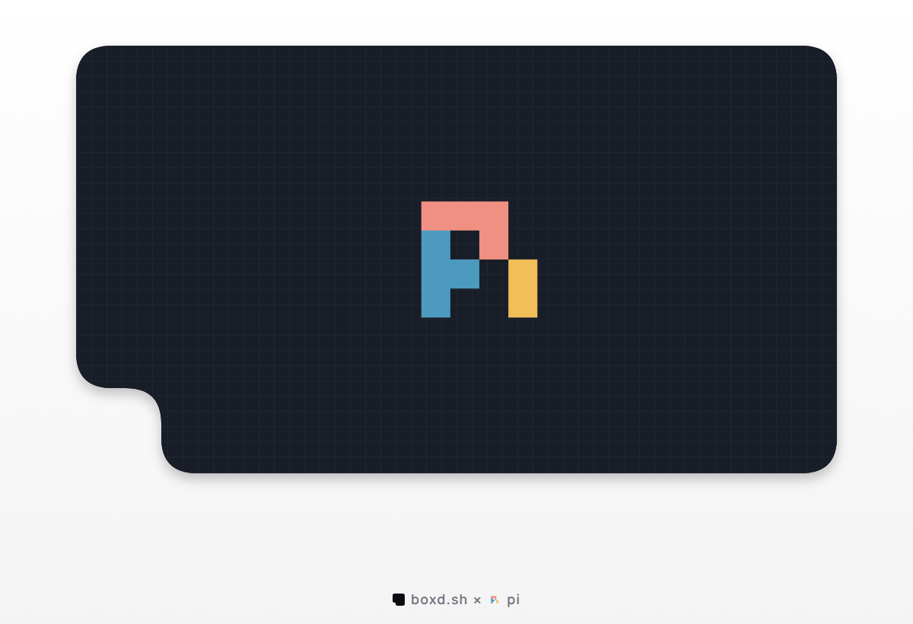

# boxd-pi

A [Pi](https://pi.dev) extension that runs Pi's tools inside a
[boxd](https://boxd.sh?ref=boxd-pi) machine. The agent runs on your computer.
`bash`, `read`, `write`, `edit`, `ls`, `find` and `grep` run in a cloud VM: one
machine per Pi session, kept with the session, hibernated when you quit and
woken when you resume.

A boxd machine is a full Ubuntu 24.04 VM (KVM microVM) with its own disk,
Docker, Node.js, Python and Go, and passwordless sudo. It boots in about a
second. Processes you start in the background keep running between tool calls
and through hibernation, and forking a Pi session forks its machine, running
processes included.

## Install

```bash
npm install -g @earendil-works/pi-coding-agent
pi install npm:@boxd-sh/pi
```

Create an API key at [app.boxd.sh/keys](https://app.boxd.sh/keys?ref=boxd-pi)
and export it:

```bash
export BOXD_API_KEY="bxd_..."
```

## Quick start

From a git checkout:

```bash
cd my-project
pi --boxd
```

The extension creates a machine, clones the checkout's `origin` at your current
branch into `/home/boxd/<repo>`, and points every tool there. The footer shows
the machine. Local changes that are not pushed are not copied.

Without a repo, for one prompt, in a machine that is deleted when Pi exits:

```bash
pi --boxd --boxd-no-repo --no-session -p "Run uname -a and tell me where you are."
```

Other ways to start:

```bash
pi --boxd --boxd-repo github.com/acme/api --boxd-branch dev   # clone another repo
pi --boxd --boxd-no-repo                                      # empty git repo in ~/workspace
pi --boxd --boxd-size 4x16 --boxd-region fra                  # bigger machine, in Frankfurt
pi --boxd --boxd-snapshot my-toolchain                        # start from a boxd snapshot
```

For a private GitHub repo the extension uses the token from your `gh` login for
the clone. The clone runs in the machine, so the machine gets the token for
that one command. It is not written to the machine's git config or disk.
`/boxd push` gives the machine your token in the same way, after the agent has
worked in it: read [SECURITY.md](https://github.com/boxd-sh/boxd-pi/blob/main/SECURITY.md) before you push from a machine
whose agent you don't trust.

## Flags

| Flag | What it does |
| --- | --- |
| `--boxd` | Run Pi's tools in a boxd machine |
| `--boxd-repo <url>` | Repo to clone (default: the `origin` of the checkout you are in) |
| `--boxd-branch <name>` | Branch to clone (default: your current branch) |
| `--boxd-no-repo` | Start in an empty git repo at `~/workspace` |
| `--boxd-snapshot <name>` | Create the machine from a boxd snapshot |
| `--boxd-size <size>` | `1x4`, `2x8`, `4x16` or `8x32` (vCPU x GiB). Default: your org's default |
| `--boxd-region <region>` | Region for new machines, e.g. `fra` or `nyc` |
| `--boxd-org <org>` | boxd org for new machines |

Without `--boxd` the extension does nothing and Pi's own tools run as usual.

## Environment

| Variable | What it does |
| --- | --- |
| `BOXD_API_KEY` | API key (or `BOXD_TOKEN`). Without either, Pi asks once per run when it has a UI |
| `BOXD_ORG` | Default org, same as `--boxd-org` |
| `BOXD_REGION` | Default region, same as `--boxd-region` |
| `BOXD_PI_NAME_PREFIX` | Prefix for machine names (default `pi-`); the name is the prefix plus the Pi session id |

## Commands

| Command | What it does |
| --- | --- |
| `/boxd` or `/boxd status` | Show the machine, its state and its URL |
| `/boxd url <port>` | Public HTTPS URL for a port in the machine |
| `/boxd hibernate` | Hibernate now; the next tool call wakes it |
| `/boxd push [branch]` | Push the machine's `HEAD` to a branch (default `pi/<session>`) of the repo the session cloned. For GitHub this gives the machine your `gh` token for that command. Git hooks don't run, and the push is refused if `origin` was changed |
| `/boxd delete [--yes]` | Delete the machine. Asks first; `--yes` skips the question, and is required in `pi -p` |

The agent also gets a `preview_url` tool. After it starts a server it can hand
you a link like `https://p3000.pi-<session>.boxd.sh`. Anyone with the link can
open it.

## Errors

A tool never falls back to your computer. When the machine can't be used, the
call fails and says so.

| What happened | What you get |
| --- | --- |
| No API key | a notice `boxd: no API key. Set BOXD_API_KEY...`, and every tool call fails with `...the tool was NOT run on your computer` |
| boxd refused the key, or the machine could not be created or set up | a notice `boxd: could not start a machine: <reason>`; a machine that start created is deleted again, and tool calls fail as above |
| A new machine or a fork is not ready within 120 seconds | the same notice; the new machine or fork is deleted. The machine a fork was copied from is kept |
| You quit while the machine is still starting | Pi waits for the start to finish, then hibernates the machine, or deletes it for an in-memory session |
| `--boxd-size` is not a boxd size | a notice `Unknown machine size "<value>". Use one of 1x4, 2x8, 4x16, 8x32.`; nothing is created |
| The clone failed (wrong URL, no access) | `could not start a machine: git clone failed: <git's message>`; the machine is deleted |
| The machine was stopped or is hibernated | the extension starts or wakes it (trying again for up to 120 seconds if it isn't ready yet) and runs the call once more |
| The machine was deleted while the session is open | `boxd machine <id> no longer exists. The tool was NOT run on your computer.` Start Pi again with `--boxd` |
| You resume a session whose machine was deleted | a new, empty machine for the session |
| A command exits non-zero | Pi's usual tool error with the output and exit code |
| A command runs past the `timeout` the agent gave it, or you press Ctrl-C | the call ends and so does the command's process in the machine |
| A file is missing, or is a directory | Pi's usual `read`/`edit` error, from the machine's filesystem |
| `/boxd push` fails | `boxd: git push failed: <git's message>` |
| `/boxd push` after `origin` in the machine was changed | `boxd: origin in the machine is <url>, not <url> that this session cloned. Nothing was pushed and your GitHub token was not sent.` |
| `/boxd push` in a workspace that was not cloned (`--boxd-no-repo`) | the push goes to the `origin` you or the agent added, without your token |

In `pi -p` and JSON mode these notices go to stderr, prefixed `[boxd-pi]`.

## Limits

| | Limit |
| --- | --- |
| Machines | one per Pi session; a forked session gets its own copy |
| In-memory sessions | the machine is deleted when Pi exits, and by boxd 24 hours after it was created at the latest, also while Pi is still running |
| Machine size | `1x4`, `2x8`, `4x16` or `8x32`, up to your org's quota |
| Machine ready | create, fork and wake wait up to 120 seconds; a new machine is usually ready in about a second |
| Clone | 10 minutes; `/boxd push` 5 minutes |
| Command timeout | the `timeout` the agent passes to `bash`, as in Pi; none by default |
| `find` / `grep` | 1000 files / 100 matches by default (the agent can ask for more), then Pi's usual output limits |
| Environment | only Pi's `PI_*` session variables go with a command |
| Local files | only what is pushed to `origin` reaches the machine |
| Preview URLs | public to anyone with the link; the first one on a machine can take up to a minute before HTTPS answers |
| Machine name | `BOXD_PI_NAME_PREFIX` plus the session id, cut to 63 characters |

## How it works

The extension overrides Pi's built-in tools with versions that call the
[boxd TypeScript SDK](https://www.npmjs.com/package/@boxd-sh/sdk):

| Pi tool | In the machine |
| --- | --- |
| `bash`, user `!` commands | a streamed exec: output arrives as it is written, Ctrl-C and timeouts end the remote process. Commands that leave a process in the background (`npm run dev &`) return when the foreground part is done, and the process keeps running |
| `read`, `write`, `edit`, `ls` | the machine filesystem API |
| `find`, `grep` | `rg` in the machine |
| `preview_url` | a boxd named proxy, `p<port>`, on the machine |

Your boxd API key never enters the machine, and nothing from your shell
environment goes with a command except Pi's `PI_*` variables. The one secret
that does reach the machine is your GitHub token, for the clone and for
`/boxd push`: see [SECURITY.md](https://github.com/boxd-sh/boxd-pi/blob/main/SECURITY.md).

| Pi does | The extension does |
| --- | --- |
| starts a session with `--boxd` | creates an isolated machine named `pi-<session id>`, labelled `created-by=boxd-pi` and `pi-session=<id>`, and records its id and region in the session |
| resumes a session (`pi -c`, `/resume`, `--session`) | wakes the recorded machine; creates a new one only if it was deleted |
| forks a session (`/fork`, `pi --fork`) | forks the parent's machine (disk, memory and running processes), then hibernates the parent's |
| quits | hibernates the machine, memory and running processes included. The next tool call wakes it |
| quits an in-memory session (`--no-session`) | deletes the machine, since the session can't be resumed. The machine also carries a 24 hour delete timer from the start, in case Pi is killed before it can delete it |

Machines are isolated: they are not on your org's private network and have no
boxd credentials inside. A machine whose session you delete stays hibernated
until you delete it with `/boxd delete` first, or from the
[boxd console](https://app.boxd.sh?ref=boxd-pi).

## Examples

Each one runs `pi -p` against real boxd and leaves no machine behind (pass
`--keep` to keep them).

- [`examples/quickstart.sh`](https://github.com/boxd-sh/boxd-pi/blob/main/examples/quickstart.sh): one prompt on a fresh
  machine, deleted when Pi exits.
- [`examples/persistent-session.sh`](https://github.com/boxd-sh/boxd-pi/blob/main/examples/persistent-session.sh): the
  first run commits a file and starts a server in the background, then Pi
  quits and the machine hibernates. Opening the preview URL wakes it, and the
  second run resumes the session: same files, server still running.
- [`examples/parallel-forks.sh`](https://github.com/boxd-sh/boxd-pi/blob/main/examples/parallel-forks.sh): set a project
  up once, fork the session twice, and let two agents try two approaches in
  parallel, each in its own copy of the machine.

```bash
pi install npm:@boxd-sh/pi
git clone https://github.com/boxd-sh/boxd-pi && cd boxd-pi
export BOXD_API_KEY=... ANTHROPIC_API_KEY=...
export PI_MODEL=claude-sonnet-5-5   # optional, any pi --model pattern
./examples/persistent-session.sh
```

They work in a scratch directory, so they never clone the repo you run them
from. `PI_BOXD_EXTENSION=.` runs them against the checkout instead of the
installed package.

## Development

```bash
git clone https://github.com/boxd-sh/boxd-pi && cd boxd-pi
npm install
npm run check      # lint, typecheck, unit tests, and an offline load test (no key, no network)
BOXD_E2E=1 BOXD_API_KEY=bxd_... npm run test:live   # end to end against boxd
```

Pi loads the TypeScript source directly, so there is no build step. To try a
local copy:

```bash
pi -e ./index.ts --boxd
```

The unit tests run the extension against a fake boxd client and a fake Pi.
`npm run test:live` drives the extension with Pi's real tool definitions
against real machines, named `pi-live-<run>-<a to f>`
(`BOXD_PI_NAME_PREFIX` changes the prefix). It deletes every machine it
creates.

## License

MIT
